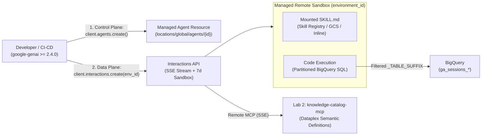

# Lab 5: Zero-Infra Managed Agents API & Low-Infra `/interactions` Harness

In **Lab 4** ([`../data_analytics_agent/`](../data_analytics_agent/)), we built a code-first **ADK Worker Agent** requiring custom Python agent classes, tool wrappers, session services, and container deployment.

In **Lab 5**, we solve the **exact same Tokenomics-governed analytics problem with zero container build and zero framework boilerplate** using two low-infrastructure primitives on Google Cloud's **Gemini Platform** (`google-genai >= 2.4.0`):

1. **Part A — Config-First Managed Agents API (`client.agents` + `client.interactions`):**
   - Provision a stateful custom agent on the control plane (`POST /v1beta1/projects/{P}/locations/global/agents`) in a single declarative call.
   - Mount a portable [`skills/tokenomics-analytics/SKILL.md`](skills/tokenomics-analytics/SKILL.md) package (from **Skill Registry**, **Cloud Storage**, or **inline**).
   - Attach the **Lab 2 Cloud Run MCP Server** (`knowledge-catalog-mcp`) and sandboxed `code_execution` with a least-privilege domain egress allowlist.
   - Reuse the returned **`environment_id`** (`7-day` rolling TTL Linux sandbox) across multi-turn interactions and dynamically override MCP tools at call time.
2. **Part B — Thin Stateful Model Harness (`low_infra_harness.py`):**
   - For teams wanting a lightweight custom loop without adopting a full framework, `run_thin_model_turn()` demonstrates driving `gemini-3.8-flash` / `gemini-4-argon` directly over `POST .../interactions` with `previous_interaction_id` (retaining encrypted `thought` signatures and warm replica cache affinity server-side) or `store=False` for stateless Zero Data Retention (ZDR).

---

## Architecture



---

## Step 1: Prerequisites & Setup

Ensure **Lab 1** (`knowledgeCatalog-bigquery-sync`) and **Lab 2** (`create-knowledge-catalog-mcp-server`) have been deployed in your Google Cloud project, then run:

```bash
cd managed-agents-api
chmod +x instructions.sh
./instructions.sh
```

`instructions.sh` enables required APIs, grants `roles/aiplatform.serviceAgent` to the platform service identity, stages [`skills/tokenomics-analytics/SKILL.md`](skills/tokenomics-analytics/SKILL.md) to `gs://<PROJECT_ID>-managed-agent-skills`, and installs `google-genai>=2.4.0`.

*(Want zero Cloud Storage setup? Skip `AGENT_SKILL_GCS_BUCKET`—`create_managed_agent.py` automatically falls back to mounting `SKILL.md` inline inside `base_environment.sources`.)*

---

## Step 2: Run Offline Contract Tests (`<1s`, No Cloud Calls Required)

Verify the `SKILL.md` frontmatter, least-privilege egress allowlist, skill mount modes (`skill_registry`, `gcs`, `inline`), and streaming event parser locally:

```bash
pytest test_managed_agent.py
```

---

## Step 3: Provision & Inspect the Custom Managed Agent

```bash
export GOOGLE_CLOUD_PROJECT="$(gcloud config get-value project)"
export CATALOG_MCP_URL="$(gcloud run services describe knowledge-catalog-mcp --region=us-central1 --format='value(status.url)')/sse"

python create_managed_agent.py
```

Copy the printed `export MANAGED_AGENT_ID="..."` line into your shell.

> [!NOTE]
> **Updating an Existing Managed Agent:** `client.agents.update()` is not yet exposed in the Python SDK; to mutate an existing agent ID in place without recreating it, send a REST `PATCH https://aiplatform.googleapis.com/v1beta1/projects/${GOOGLE_CLOUD_PROJECT}/locations/global/agents/${MANAGED_AGENT_ID}?updateMask=systemInstruction,tools,baseEnvironment`.

---

## Step 4: Execute Multi-Turn Governance & Sandbox Persistence Checks

```bash
python test_managed_agent.py
```

This runs three live turns against your Managed Agent:
1. **Turn 1 (Zero-Scan Metric Lookup):** Resolves the official `bounce_rate` SQL formula via `knowledge-catalog-mcp` with **zero BigQuery scans**, writes `/tmp/metric_note.txt`, and captures `environment_id`.
2. **Turn 2 (Persistent Sandbox Reuse):** Passes `environment=t1.environment_id` to verify `/tmp/metric_note.txt` persists across turns and retrieves `ga_sessions` `_TABLE_SUFFIX` partition rules from the catalog.
3. **Turn 3 (Partition-Governed Query + Dynamic MCP Override):** Executes the Aug 1, 2017 top traffic sources query with `_TABLE_SUFFIX = '20170801'` while demonstrating interaction-time `tools=[{"type": "mcp_server", ...}]` overrides.

---

## Step 5: Clean Up

 Managed Agent definitions persist on the control plane until explicitly deleted:

```bash
python cleanup_managed_agent.py
```
