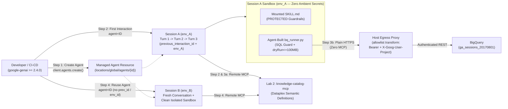

# Lab 5: Zero-Infra Managed Agents API & Low-Infra `/interactions` Harness

In **Lab 4** ([`../data_analytics_agent/`](../data_analytics_agent/)), we built a code-first **ADK Worker Agent** requiring custom Python agent classes, `BigQueryToolset` wrappers, session services, and container deployment.

In **Lab 5**, we solve the **same Tokenomics-governed analytics problem on the Qwiklabs dataset (`ga_sessions_*`) with zero container build and zero BigQuery MCP server** using Google Cloud's **Gemini Platform** (`google-genai >= 2.4.0`).

---

## The 4 Core Managed Agent Lifecycle Steps (Part A)

This lab walks explicitly through the four foundational lifecycle operations of the **Managed Agents API** (`client.agents`), **Interactions API** (`client.interactions`), and **Environments API** (`client.environments`):

| Step | Capability | SDK Call & State Handles | What Happens in This Lab |
| :--- | :--- | :--- | :--- |
| **1. Create the Agent** | Provision a reusable control-plane agent definition once | `client.agents.create(id=..., base_agent=..., system_instruction=..., tools=..., base_environment=...)` $\rightarrow$ `MANAGED_AGENT_ID` | Registers a custom agent mounting [`skills/tokenomics-analytics/SKILL.md`](skills/tokenomics-analytics/SKILL.md) (with an immutable `<!-- PROTECTED:START -->` compliance block), `code_execution`, and Lab 2's `knowledge-catalog-mcp`. |
| **2. Use the Agent with Interactions API** | Start an initial interaction against the agent | `client.interactions.create(agent=MANAGED_AGENT_ID, input=..., stream=True)` $\rightarrow$ returns `t1.interaction_id` + `t1.environment_id` | **Session A — Turn 1:** Streams SSE events (`step.start`, `step.delta`) while resolving `bounce_rate` and `ga_sessions` `_TABLE_SUFFIX` partition rules from the Knowledge Catalog with **zero BigQuery scan**. |
| **3. Follow Up on Previous Interaction** | Continue the same conversation & persistent sandbox | `client.interactions.create(agent=MANAGED_AGENT_ID, previous_interaction_id=t1.interaction_id, environment={..., "environment_id": t1.environment_id}, ...)` | **Session A — Turns 2 & 3:** Chains conversation memory (`previous_interaction_id`) **and** reattaches to the `7-day` Linux sandbox (`environment_id`) so the agent builds, unit-tests, and executes `/tmp/bq_runner.py` against `bigquery.googleapis.com` via zero-secret proxy header injection (`network.allowlist[].transform`) with **zero MCP attached** on Turn 3. |
| **4. Reuse the Agent for Next Interaction** | Invoke the same `agent` for a brand-new session/user | `client.interactions.create(agent=MANAGED_AGENT_ID, input=...)` *(omits `previous_interaction_id` and `environment_id`)* $\rightarrow$ new `t4.interaction_id` + clean `t4.environment_id` | **Session B — Turn 1:** Reuses the exact same `MANAGED_AGENT_ID` control-plane definition in a fresh conversation and clean, isolated sandbox (verifying `monthly-active-users` formula and confirming Session A's `/tmp/bq_runner.py` is absent). |

> **Part B Bonus (`low_infra_harness.py`):** For teams driving foundation models (`gemini-3.8-flash` / `gemini-4-argon`) directly without an autonomous sandbox agent, **Lab Step 5** compares multi-turn `previous_interaction_id` prefix-cache & `thought` chaining against `store=False` stateless Zero Data Retention (ZDR).

---

## Architecture



### State Primitives at a Glance

| State Handle | Scope | What It Preserves Across Calls | When to Pass vs. Omit |
| :--- | :--- | :--- | :--- |
| **`agent`** (`MANAGED_AGENT_ID`) | **Control Plane (Project-wide)** | `base_agent`, `system_instruction`, mounted `SKILL.md`, default `tools`, and default `network.allowlist`. | **Pass on every call** to reuse the same governed agent across all sessions and users. |
| **`previous_interaction_id`** | **Conversation History (`steps[]`)** | Prior user/agent messages, tool call outputs, and encrypted `thought` lineage (`store=True` required). | **Pass in Step 3** to follow up on a prior turn; **omit in Step 4** to start a fresh conversation. |
| **`environment_id`** | **Remote Sandbox Disk (`7-day` TTL)** | Workspace & `/tmp` files written inside `code_execution` (inspectable via `client.environments`). | **Pass in Step 3** to keep `/tmp/bq_runner.py` across turns; **omit in Step 4** for a clean isolated sandbox. |

---

## Prerequisites: Setup & Offline Contract Check

Ensure **Lab 1** (`knowledgeCatalog-bigquery-sync`) and **Lab 2** (`create-knowledge-catalog-mcp-server`) have been deployed in your Qwiklabs / Google Cloud project, then run:

```bash
cd managed-agents-api
chmod +x instructions.sh
./instructions.sh
```

`instructions.sh` enables required APIs, grants `roles/aiplatform.serviceAgent` to the platform service identity, stages [`skills/tokenomics-analytics/SKILL.md`](skills/tokenomics-analytics/SKILL.md) to `gs://<PROJECT_ID>-managed-agent-skills`, and installs `google-genai>=2.4.0`. *(Leave `AGENT_SKILL_GCS_BUCKET` unset if you prefer zero-setup inline `SKILL.md` mounting.)*

Run the offline contract suite (`<1s`, zero cloud calls) to verify the `SKILL.md` `PROTECTED` compliance block, `CreateAgentInteraction` schema validation for `previous_interaction_id`, proxy header `transform` isolation, SSE `environment_id` fallback hydration, and fresh agent reuse:

```bash
pytest test_managed_agent.py
```

---

## Lab Step 1: Creating the Managed Agent (`client.agents.create`)

Provision the persistent Managed Agent once on the control plane (`locations/global`):

```bash
export GOOGLE_CLOUD_PROJECT="$(gcloud config get-value project)"
export CATALOG_MCP_URL="$(gcloud run services describe knowledge-catalog-mcp --region=us-central1 --format='value(status.url)')/sse"

python create_managed_agent.py
```

Copy the printed `export MANAGED_AGENT_ID="..."` line into your shell. Under the hood, [`create_managed_agent.py`](create_managed_agent.py) registers:
- `base_agent="antigravity-preview-05-2026"` (with optional `agent_config` overrides via `MANAGED_AGENT_MODEL` / `MANAGED_AGENT_MAX_TOKENS`)
- `tools`: `[{"type": "code_execution"}, {"type": "mcp_server", "name": "knowledge-catalog-mcp", "url": CATALOG_MCP_URL}]`
- `base_environment`: mounts [`skills/tokenomics-analytics/SKILL.md`](skills/tokenomics-analytics/SKILL.md) (`skill_registry`, `gcs`, or `inline`) and restricts outbound egress to `bigquery.googleapis.com` and your Cloud Run MCP host.

> [!NOTE]
> **Updating an Existing Managed Agent:** `client.agents.update()` is not yet exposed in the Python SDK; to update an existing agent ID in place without recreating it, send a REST `PATCH https://aiplatform.googleapis.com/v1beta1/projects/${GOOGLE_CLOUD_PROJECT}/locations/global/agents/${MANAGED_AGENT_ID}?updateMask=systemInstruction,tools,baseEnvironment`.

---

## Lab Steps 2–4: Interactions API, Follow-Up Chaining & Agent Reuse

Run the live verification script to execute **Steps 1 through 4** end-to-end against your `MANAGED_AGENT_ID`:

```bash
python test_managed_agent.py
```

Here is what [`test_managed_agent.py`](test_managed_agent.py) and [`low_infra_harness.py`](low_infra_harness.py) execute at each step:

### Lab Step 2 — Using the Agent with the Interactions API (Initial Turn)

Starts **Session A** against `agent=MANAGED_AGENT_ID` with no prior state handles. The agent queries `knowledge-catalog-mcp` for the official `bounce_rate` SQL formula and `ga_sessions` `_TABLE_SUFFIX` partition rule (**zero BigQuery scan**) and returns both `t1.interaction_id` and `t1.environment_id`:

```python
t1 = run_managed_interaction(
    client,
    agent=agent_id,
    prompt=(
        "Look up our official business formula for bounce rate and the required partition "
        "key for ga_sessions in the Knowledge Catalog without running any BigQuery SQL."
    ),
    environment=build_bigquery_proxy_environment(project_id, catalog_mcp_url=catalog_mcp_url),
)
# Returns: t1.interaction_id (conversation turn ID) + t1.environment_id (7-day sandbox ID)
```

### Lab Step 3 — Following Up on the Previous Interaction (`previous_interaction_id` + `environment_id`)

Continues **Session A** by passing **both** `previous_interaction_id` (preserving prior conversation context and `thought` steps) and `environment_id` (preserving the Linux sandbox filesystem):

1. **Follow-Up 3a (`previous_interaction_id=t1.interaction_id`, `environment_id=t1.environment_id`):** References the `ga_sessions` partition rule from Step 2 without repeating it, builds `/tmp/bq_runner.py` (mirrored to `./bq_runner.py`) inside `code_execution`, unit-tests its local `SELECT *` and `_TABLE_SUFFIX` guards, and snapshots the workspace via `client.environments.files.list()`.
2. **Follow-Up 3b (`previous_interaction_id=t2.interaction_id`, `environment_id=t1.environment_id`, `tools=[{"type": "code_execution"}]`):** Detaches all MCP servers and injects a short-lived BigQuery OAuth header at the **host egress proxy** (`network.allowlist[].transform`) so zero credentials ever enter sandbox memory or env vars. The agent executes `/tmp/bq_runner.py` from Step 3a, enforces `dryRun <= 100 MB`, and queries `ga_sessions_20170801` for the top 3 traffic sources:

```python
t3 = run_managed_interaction(
    client,
    agent=agent_id,
    previous_interaction_id=t2.interaction_id,  # Chains Session A conversation history
    prompt="Now run ONLY your /tmp/bq_runner.py CLI for August 1, 2017 (`_TABLE_SUFFIX = '20170801'`).",
    environment=build_bigquery_proxy_environment(
        project_id,
        bq_access_token=mint_bigquery_access_token(),
        environment_id=t1.environment_id,       # Reattaches Session A sandbox disk
    ),
    tools=[{"type": "code_execution"}],         # Zero MCP attached on this turn
)
```

### Lab Step 4 — Reusing the Same Agent for the Next Independent Interaction (Fresh Session)

Invokes the **same `MANAGED_AGENT_ID`** while omitting both `previous_interaction_id` and `environment_id`. Without re-creating the agent or re-uploading `SKILL.md`, **Session B** starts with clean conversation memory and a brand-new isolated sandbox (`t4.environment_id != t1.environment_id`, with no leftover `/tmp/bq_runner.py` from Session A):

```python
t4 = run_managed_interaction(
    client,
    agent=agent_id,  # Same control-plane Managed Agent ID — no previous_interaction_id or environment_id
    prompt=(
        "What is our official Knowledge Catalog definition and SQL formula for Monthly Active "
        "Users (monthly-active-users)? Also check via code_execution whether /tmp/bq_runner.py "
        "exists in this fresh sandbox."
    ),
    environment=build_bigquery_proxy_environment(project_id, catalog_mcp_url=catalog_mcp_url),
)
assert t4.previous_interaction_id is None
assert t4.environment_id != t1.environment_id
```

---

## Lab Step 5: Thin Model-Only `/interactions` Harness vs. ZDR Mode (Part B)

Compare multi-turn `previous_interaction_id` prefix-cache & `thought` chaining against `store=False` stateless Zero Data Retention directly on `gemini-3.8-flash` (with zero agent container or sandbox):

```bash
python low_infra_harness.py
```

---

## Lab Step 6: Clean Up

Managed Agent definitions and `7-day` remote sandboxes can be deleted explicitly when finished (or automatically by passing `--cleanup` to `python test_managed_agent.py --cleanup`):

```bash
python cleanup_managed_agent.py --agent-id "$MANAGED_AGENT_ID"
```
