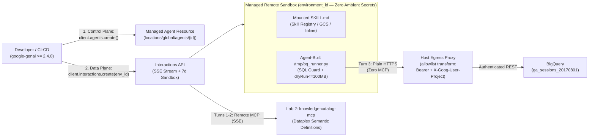

# Lab 5: Zero-Infra Managed Agents API & Low-Infra `/interactions` Harness

In **Lab 4** ([`../data_analytics_agent/`](../data_analytics_agent/)), we built a code-first **ADK Worker Agent** requiring custom Python agent classes, `BigQueryToolset` wrappers, session services, and container deployment.

In **Lab 5**, we solve the **same Tokenomics-governed analytics problem on the Qwiklabs dataset (`ga_sessions_*`) with zero container build and zero BigQuery MCP server** using two low-infrastructure primitives on Google Cloud's **Gemini Platform** (`google-genai >= 2.4.0`):

1. **Part A — Config-First Managed Agents API (`client.agents` + `client.interactions`):**
   - Provision a stateful custom agent on the control plane (`POST /v1beta1/projects/{P}/locations/global/agents`) in a single declarative call.
   - Mount a portable [`skills/tokenomics-analytics/SKILL.md`](skills/tokenomics-analytics/SKILL.md) package (from **Skill Registry**, **Cloud Storage**, or **inline**).
   - Attach **Lab 2's `knowledge-catalog-mcp`** strictly for semantic catalog discovery, while the Managed Agent **writes, unit-tests, and runs its own Python BigQuery CLI (`/tmp/bq_runner.py`) inside `code_execution` with zero BigQuery MCP dependency**.
   - Authenticate outbound sandbox calls to `bigquery.googleapis.com` via **host egress proxy header injection (`network.allowlist[].transform`)** so **zero OAuth tokens or credentials ever enter sandbox memory, disk, or env vars**.
   - Reuse the returned **`environment_id`** (`7-day` rolling TTL Linux sandbox) so `/tmp/bq_runner.py` persists across turns, and pass `tools=[{"type": "code_execution"}]` on Turn 3 to prove BigQuery runs purely via the agent-built script.
2. **Part B — Thin Stateful Model Harness (`low_infra_harness.py`):**
   - For teams wanting a lightweight custom loop without adopting a full framework, `run_thin_model_turn()` drives `gemini-3.8-flash` / `gemini-4-argon` directly over `POST .../interactions` with `previous_interaction_id` (retaining encrypted `thought` signatures and warm replica cache affinity server-side) or `store=False` for stateless Zero Data Retention (ZDR).

---

## Architecture



---

## Step 1: Prerequisites & Setup

Ensure **Lab 1** (`knowledgeCatalog-bigquery-sync`) and **Lab 2** (`create-knowledge-catalog-mcp-server`) have been deployed in your Qwiklabs / Google Cloud project, then run:

```bash
cd managed-agents-api
chmod +x instructions.sh
./instructions.sh
```

`instructions.sh` enables required APIs, grants `roles/aiplatform.serviceAgent` to the platform service identity, stages [`skills/tokenomics-analytics/SKILL.md`](skills/tokenomics-analytics/SKILL.md) to `gs://<PROJECT_ID>-managed-agent-skills`, and installs `google-genai>=2.4.0`.

*(Want zero Cloud Storage setup? Skip `AGENT_SKILL_GCS_BUCKET`—`create_managed_agent.py` automatically mounts `SKILL.md` inline inside `base_environment.sources`.)*

---

## Step 2: Run Offline Contract Tests (`<1s`, No Cloud Calls Required)

Verify the `SKILL.md` frontmatter, proxy header `transform` isolation (confirming tokens never enter `environment.env`), skill mount modes (`skill_registry`, `gcs`, `inline`), and streaming `code_execution_call` tracking locally:

```bash
pytest test_managed_agent.py
```

---

## Step 3: Provision & Inspect the Custom Managed Agent

```bash
export GOOGLE_CLOUD_PROJECT="$(gcloud config get-value project)"
export CATALOG_MCP_URL="$(gcloud run services describe knowledge-catalog-mcp --region=us-central1 --format='value(status.url)')/sse"

python create_managed_agent.py
```

Copy the printed `export MANAGED_AGENT_ID="..."` line into your shell.

> [!NOTE]
> **Updating an Existing Managed Agent:** `client.agents.update()` is not yet exposed in the Python SDK; to mutate an existing agent ID in place without recreating it, send a REST `PATCH https://aiplatform.googleapis.com/v1beta1/projects/${GOOGLE_CLOUD_PROJECT}/locations/global/agents/${MANAGED_AGENT_ID}?updateMask=systemInstruction,tools,baseEnvironment`.

---

## Step 4: Execute Multi-Turn Self-Built BigQuery Tool Verification

```bash
python test_managed_agent.py
```

This runs three live turns against your Managed Agent using the exact Qwiklabs dataset from Labs 1–2:
1. **Turn 1 (Zero-Scan Metric Lookup):** Resolves the official `bounce_rate` SQL formula via `knowledge-catalog-mcp` with **zero BigQuery scans** and captures `environment_id`.
2. **Turn 2 (Build & Self-Test `/tmp/bq_runner.py` in Persistent Sandbox):** Reattaches to `t1.environment_id`, fetches `ga_sessions` `_TABLE_SUFFIX` partition rules from the catalog, writes `/tmp/bq_runner.py` in Python stdlib `urllib.request`, and runs local unit assertions confirming `SELECT *` and unpartitioned queries are blocked before any HTTP call.
3. **Turn 3 (Pure `code_execution` BigQuery Run — Zero MCP Attached):** Overrides `tools=[{"type": "code_execution"}]` (detaching all MCP servers) and attaches short-lived proxy header injection (`network.allowlist[].transform`) for `bigquery.googleapis.com`. The agent runs `/tmp/bq_runner.py` from its persistent sandbox, verifies `dryRun` bytes (`<= 100 MB`), queries `bigquery-public-data.google_analytics_sample.ga_sessions_*` (`_TABLE_SUFFIX = '20170801'`), and reports exact visit counts and dry-run bytes.

---

## Step 5: Clean Up

Managed Agent definitions persist on the control plane until explicitly deleted:

```bash
python cleanup_managed_agent.py
```
